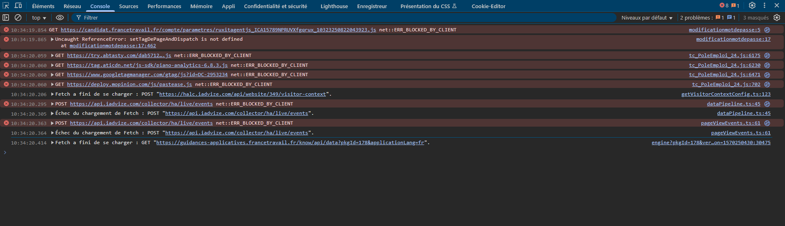
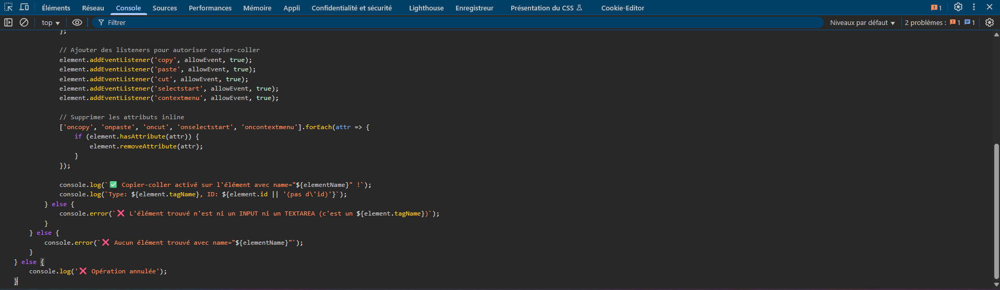
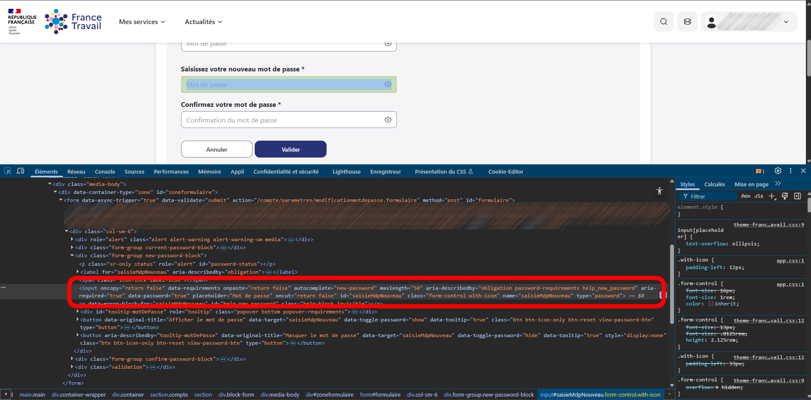
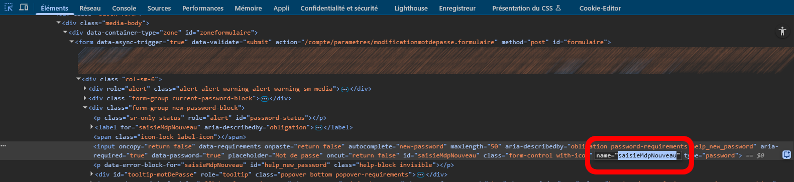
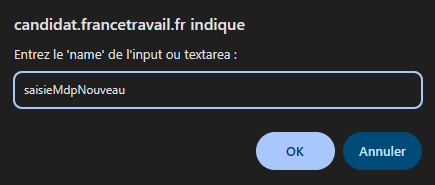
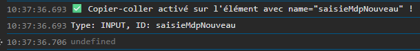
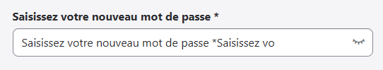
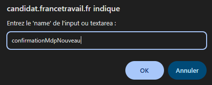
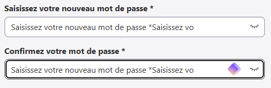

# France Travail - Activer le copier-coller

Réactive le copier-coller sur les champs qui le bloquent (handler onpaste), notamment la page de changement de mot de passe. Blocage absurde à l'ère des gestionnaires de mots de passe autogénérés.

Optimisé pour `https://candidat.francetravail.fr/compte/parametres/modificationmotdepasse`, mais le code fonctionne sur n'importe quel site qui bloque le collage.

## Deux façons de l'utiliser

### 1. Bookmarklet (un clic, recommandé)

Ouvre **`install.html`** dans Chrome, puis glisse le bouton bleu vers ta barre de favoris (`Ctrl + Maj + B` pour l'afficher). Ensuite, sur la page bloquée, clique sur le favori.

Note : Chrome ne permet pas d'ajouter un bookmarklet en téléchargeant un fichier. Le glisser-déposer du lien est la seule méthode fiable.

### 2. Console

**Étape 1 : ouvrir la console DevTools** (`F12`, ou `Ctrl + Maj + J` sur Windows/Linux, `Cmd + Option + J` sur Mac).

**Étape 2 : coller le script.** Copie tout le contenu de `france-travail-enable-copy-paste.js`, colle dans la console, Entrée.

**Étape 3 : entrer le `name` du champ.** Une popup le demande. Pour le trouver : clic droit sur le champ -> Inspecter -> cherche l'attribut `name="..."`.

**Étape 4 : vérifier.** Un message ✅ confirme l'activation dans la console, et le collage fonctionne.

Recommence pour le champ suivant (ex. confirmation du mot de passe).

## Notes

Le script agit sur la page courante uniquement. Relance-le après un rechargement de page. Certains sites peuvent avoir des protections supplémentaires.

Exemples de `name` courants : `email`, `password`, `username`, `confirm-password`.

## Fichiers

| Fichier | Rôle |
| --- | --- |
| `france-travail-enable-copy-paste.js` | Script source, lisible, pour la console |
| `install.html` | Page d'installation du bookmarklet (glisser-déposer) |
| `images/` | Captures d'écran du tutoriel |

## Licence

[MIT](https://opensource.org/licenses/MIT).
